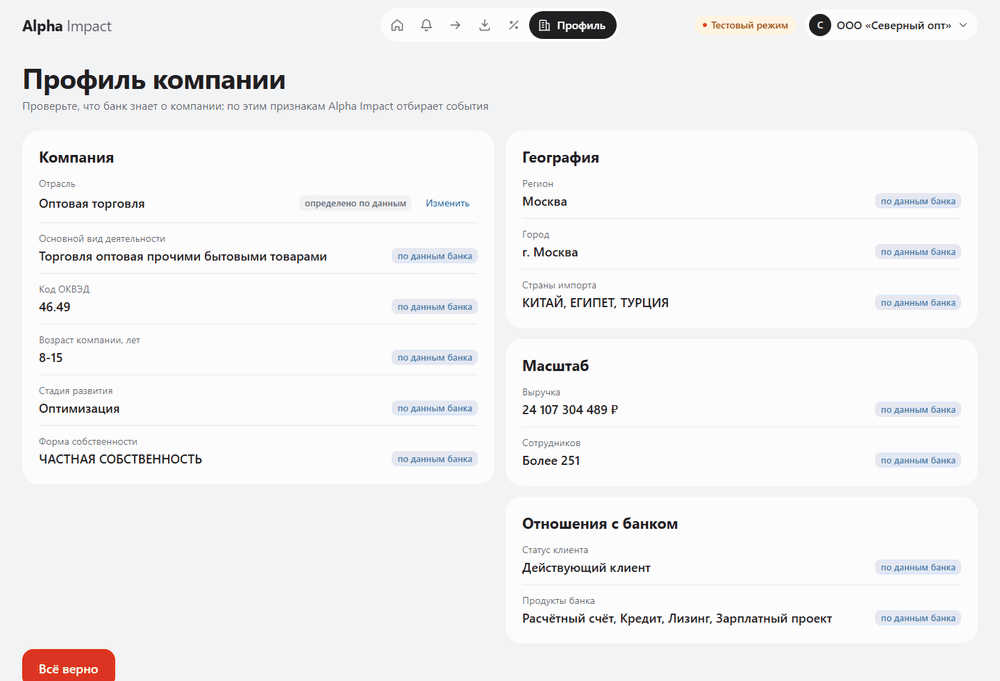
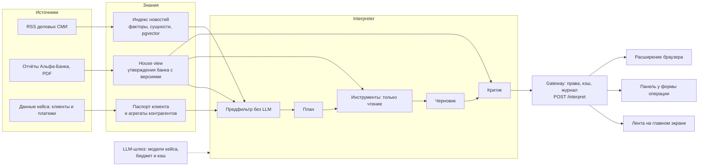

# Alpha Impact

<p align="center">
  
</p>

**Банк говорит в ту секунду, когда информация стоит денег, — и молчит, когда сказать нечего.**

Alpha Impact — сервис в интернет-банке Альфа-Бизнес, который превращает поток новостей и аналитику Альфа-Банка в персональную ленту событий для крупного бизнеса (выручка от 15 млрд ₽). Каждое событие объяснено по шести вопросам кейса: что произошло, почему это важно именно этой компании, какие последствия, что можно сделать, как это оценивает банк и на чём основан вывод. У каждого тезиса видна природа — **факт**, **позиция банка** или **вывод AI** — и источник.

Хакатон Альфа-Банка, кейс «Новостная аналитика для принятия бизнес-решений». Коротко о сути и текущем состоянии — [docs/SUMMARY.md](docs/SUMMARY.md), концепция — [docs/CONCEPT.md](docs/CONCEPT.md), сценарий показа — [docs/DEMO.md](docs/DEMO.md).

## Что умеет

- **Персональная лента на главном экране.** Сервис знает компанию по данным банка — отрасль, регион, масштаб, ВЭД, продукты, контрагенты, группа — и отбирает только события, которые её касаются. У двух компаний лента разная; полный список за 14 дней — по значимости.
- **Аналитика в момент действия.** Те же события появляются рядом с формой платежа, депозита или кредита, когда задевают именно эту операцию: платёж перевозчику — карточка о логистике и доле перевозчиков в оттоке клиента, депозит — позиция банка по ставке с расчётом дохода.
- **Явное молчание.** Если важного нет, сервис так и говорит: «Пока ничего важного для вашего бизнеса», а не показывает пустоту или натянутую связь.
- **Позиция банка — дословно и с датой.** Тезис «Банк» цитирует подтверждённое утверждение из отчёта Альфа-Банка и ведёт на страницу PDF; устаревшие утверждения текущими не цитируются.
- **Критик.** Вторая модель проверяет черновик: у каждого тезиса есть источник, позиция банка не пересказана и не противоречит отчёту. Непроверенная карточка помечена.
- **Роли.** Финдиректор и казначей видят одно событие под разным углом: свои «почему важно» и «что сделать».
- **Живая новость.** Кнопка «Вставить новость» на главном экране: свежая статья размечается и превращается в карточку за минуту.
- **Расширение браузера.** На странице делового СМИ или карточки контрагента — подсказка и боковая панель с той же карточкой. Один API — три места показа.
- **«Как получен вывод».** У каждой карточки — трасса: план агента, вызванные инструменты, черновик, вердикт критика, модели, токены и рубли.

## Как это работает



Бэкенд — модульный монолит на Python 3.12 и FastAPI: каждая способность — изолированный сервис, общий у них только пакет контрактов. Фронт — React 18 и TypeScript: макет Альфа-Бизнеса и библиотека `InsightPanel`, которую встраивают и приложение, и расширение Manifest V3. Модели — только из списка кейса (Gemma 4, GLM-5.3, Qwen3.6, DeepSeek-V4.1), каждый вызов идёт через шлюз с учётом токенов, кэшем и дневным бюджетом. Подробно — [docs/ARCHITECTURE.md](docs/ARCHITECTURE.md).

## Запуск

Нужен только Docker: Docker Desktop (Windows, macOS) или Docker Engine с Compose v2, около 6 ГБ на диске и свободные порты 5432 (база), 8000 (API) и 5173 (приложение). Команды — из корня репозитория.

1. **Данные кейса.** Положите в `backend/data/raw` файлы кейса: `df_Uid_data_hack.csv`, `df_Uid_payment_hack.csv` и PDF отчётов банка (по ним открываются ссылки «Банк» в карточках).
2. **Ключ LLM.** Скопируйте `.env.example` в `.env` и впишите ключ кейса в `LLM_API_KEY`. Остальные настройки уже заданы в `.env.example`.
3. **Сборка и старт** — база (PostgreSQL 16 + pgvector), API и фронт:
   ```
   docker compose up -d --build --wait
   ```
4. **Данные в базу** — тестовые пользователи, позиция банка, паспорта клиентов и граф платежей:
   ```
   docker compose --profile seed run --build --rm seed
   ```
5. **Индекс новостей** — свежие статьи из RSS, разметка моделью (около 500 новостей за 14 дней: 30–40 минут и 4–5 ₽ из бюджета ключа; повтор размечает только новое):
   ```
   docker compose --profile seed run --build --rm -e LLM_TIMEOUT_SECONDS=30 seed python -m scripts.ingest_news
   ```
6. **Открыть** [http://localhost:5173](http://localhost:5173). API и его документация — [http://localhost:8000/docs](http://localhost:8000/docs).

Перед показом прогрейте кэш сценария демо — тогда карточки открываются мгновенно (кэш живёт час, `CACHE_TTL_SECONDS`). Прогрев действует, пока профиль компании не меняли: правка поля на экране профиля меняет ключ кэша, после неё прогрев нужно повторить.

```
docker compose --profile seed run --rm -e LLM_TIMEOUT_SECONDS=30 -e LLM_INTERACTIVE_TIMEOUT_SECONDS=30 seed python -m scripts.warm_demo
```

**Расширение браузера** собирается вместе с фронтом. Достаньте его из контейнера (папка `alpha-impact-extension` в `.gitignore`; после пересборки удалите её и скопируйте заново) и загрузите в Chrome: `chrome://extensions` → «Режим разработчика» → «Загрузить распакованное» → папка `alpha-impact-extension`. Затем в popup расширения войдите тестовым пользователем и выберите компанию и роль.

```
docker compose cp front:/app/app-plugin/dist-extension ./alpha-impact-extension
```

Остановить — `docker compose down`; данные базы остаются в томе `dbdata` (`docker compose down -v` удаляет и их).

## Тестовые аккаунты

Вход — по id тестового пользователя на странице `/login`, без пароля; при первом входе — выбор роли (финдиректор, казначей, собственник, генеральный директор, главный бухгалтер), потом её меняют на `/role`. Чтобы сменить пользователя, откройте `/login` снова.

| Пользователь | Кто | Компании |
|---|---|---|
| `user_cfo_wholesale` | финдиректор оптовой торговли | ООО «Северный опт» (`U_1941`), АО «СтройЛизинг» (`U_9250`) |
| `user_cfo_autodealer` | финдиректор автодилера | ООО «Автомир Поволжье» (`U_44245`) |
| `user_cfo_construction` | финдиректор строительной группы | АО «СтройЛизинг» (`U_9250`) |
| `user_cfo_nocard` | финдиректор компании, о которой нечего сказать | АО «Транзит Групп» (`U_235754`) |

## Сценарий проверки

Полный сценарий с тем, что вводить, — [docs/DEMO.md](docs/DEMO.md); ручные проверки по экранам — [docs/MANUAL_CHECKS.md](docs/MANUAL_CHECKS.md).

1. Войти за `user_cfo_wholesale`, роль «Финансовый директор»: экран профиля компании — отрасль, импорт, продукты банка; «Всё верно» (поля не правьте, если кэш уже прогрет).
2. Главный экран: виджет «Что изменилось вокруг ваших операций» — три главных события; «Все события» — полный список; переключить компанию в шапке на «СтройЛизинг» — лента другая; заголовок события открывает полную карточку.
3. «Платежи»: получатель «Северо-Западная логистика», 4 500 000 ₽ — справа карточка с пометками факт / банк / AI и ссылкой на отчёт банка.
4. Открыть `/login`, войти за `user_cfo_nocard` с ролью «Финансовый директор»: виджет явно пишет «Пока ничего важного для вашего бизнеса».
5. Снова `/login` и `user_cfo_wholesale`, «Депозиты»: 50 000 000 ₽ на 3 и на 6 месяцев — позиция банка по ставке и расчёт дохода.
6. Сменить роль на «Казначей» (`/role`) и повторить платёж — другие «почему важно» и «что сделать»; вернуть роль финдиректора.
7. Главный экран → «Вставить новость»: текст и ссылка шага 7 из [docs/DEMO.md](docs/DEMO.md) → карточка → «Как получен вывод»: план, инструменты, критик, токены.
8. Расширение (после входа в его popup): статья Коммерсанта или Ведомостей → плашка «Открыть» → карточка в боковой панели. Живая статья не прогрета: ответ идёт от модели, до минуты.
9. Метрики качества: [http://localhost:5173/api/metrics?since=2026-10-23](http://localhost:5173/api/metrics?since=2026-10-23) в той же вкладке, где выполнен вход, — доля тезисов с источником, критик с первого раза, доля молчания, токены и рубли на карточку, доля кэша.

Сценарий целиком проверяет Playwright при поднятом стенде с прогревом (нужен Node 22; для показа он не нужен):

```
cd frontend && npm ci && npx playwright install chromium && npx playwright test demo.spec.ts
```

## Переменные окружения

Все значения по умолчанию — в `.env.example`; в `.env` достаточно ключа. Адреса базы и прокси API (`DB_URL`, `TEST_DB_URL`, `API_PROXY_TARGET`) compose подставляет сам; они нужны только командам с хоста из раздела для разработчиков.

| Переменная | Что задаёт |
|---|---|
| `LLM_API_KEY` | ключ LLM кейса — единственное обязательное значение |
| `LLM_API_BASE` | адрес прокси моделей кейса |
| `MODEL_ANNOTATE`, `MODEL_INTERPRET`, `MODEL_CRITIC`, `MODEL_FOLLOWUP`, `MODEL_EXTRACT` | модели для разметки новостей, плана и черновика, критика, уточняющего вопроса и извлечения утверждений банка из страниц отчётов — только из списка кейса |
| `LLM_DAILY_BUDGET_RUB`, `LLM_BUDGET_RESERVE_SHARE`, `LLM_CALL_RESERVE_RUB` | дневной бюджет на модели, его резерв и резерв на один вызов |
| `LLM_TIMEOUT_SECONDS`, `LLM_INTERACTIVE_TIMEOUT_SECONDS` | таймаут вызова модели: обычный и для плана и черновика карточки |
| `LLM_CACHE_TTL_SECONDS`, `CACHE_TTL_SECONDS` | срок кэша ответов модели и кэша карточек `/interpret` |
| `RELEVANCE_THRESHOLD` | порог значимости события для компании |
| `EXTENSION_TOKEN_TTL_SECONDS` | срок токена расширения |
| `NEWS_RSS_URLS` | ленты деловых СМИ для индекса новостей |

## Команда

| | Кто | За что отвечает |
|---|---|---|
| Участник 1 | Михаил Железняков | фронт, `InsightPanel`, расширение, демо, сдача |
| Участник 2 | Дмитрий Редняков | данные, house view, индекс новостей, платформа бэкенда |
| Участник 3 | Артём Калюжный | LLM-шлюз, interpreter, критик, регрессия |

Лицензия — [LICENSE](LICENSE), сторонние компоненты — [THIRD_PARTY_NOTICES.md](THIRD_PARTY_NOTICES.md).

## Для разработчиков

<details>
<summary>Процесс команды, команды с хоста, индекс новостей, метрики, тесты</summary>

### Как работать в команде

1. Поставить Git и своего агента (Claude Code, Codex или Gemini CLI), принять приглашения в GitHub-репозиторий и в Jira `alphaimpact2.atlassian.net`.
2. Склонировать репозиторий, запустить агента в его корне и написать `/setup` (в Codex — `$setup`). Агент поставит и проверит остальное; руками — войти в GitHub и Jira, когда он попросит, и вписать ключ LLM в `.env`.
3. Дальше только команды:
   - `/task` — следующая задача из вашей очереди;
   - `/task AH-7` — конкретная задача;
   - `/task Ревью AH-7` — проверить и смержить PR, где вы ревьюер.

Агент сам ведёт ветку, тесты, PR и статусы в Jira и останавливается дважды: одобрить план и ответить «да» перед push; в ревью — «да» перед мержем. Подробно — [docs/PIPELINE.md](docs/PIPELINE.md).

### Команды для разработки

Все команды — из корня репозитория.

```
docker compose up -d --build    # db (postgres + pgvector), api и front: http://localhost:8000/health, http://localhost:5173
docker compose down
```

Первая сборка образа скачивает модель эмбеддингов `multilingual-e5-small` (~0,5 ГБ); правка кода или зависимостей её не перекачивает.

Настройки берутся из `.env.example`; свои значения (например, ключ LLM) — в `.env` в корне: `cp .env.example .env`. Этот же `.env` нужен командам, которые запускаются с хоста:

```
cd backend && uv run python -m scripts.download_embedder                                    # модель эмбеддингов для тестов и запусков с хоста, один раз
cd backend && uv run --env-file ../.env python -m scripts.seed                              # тестовые пользователи из backend/data/seed
cd backend && uv run python -m scripts.gen_schemas && cd ../frontend && npm run gen:types   # JSON Schema и типы фронта из контрактов
docker compose up -d --build --wait && cd frontend && npm run e2e                           # e2e (Playwright)
```

Индекс новостей собирает отдельная команда: ей нужен ключ LLM, повторный запуск размечает только новые новости и те, что в прошлый раз не разметились:

```
docker compose --profile seed run --build --rm -e LLM_TIMEOUT_SECONDS=30 seed python -m scripts.ingest_news   # RSS из NEWS_RSS_URLS → разметка → news
```

Ссылка на страницу отчёта банка в карточке (AH-33) открывает PDF кейса из `backend/data/raw`: положите туда отчёты (те же, что для `scripts.ingest_reports`); api монтирует папку только для чтения. Без файла ссылка отвечает 404.

Расширение браузера собирается вместе с фронтом в `frontend/app-plugin/dist-extension` и ходит в API на `http://127.0.0.1:8000` — другой хост cookie, чем у приложения на `localhost`, поэтому вход в расширение не меняет сессию приложения:

```
cd frontend && npm run build    # chrome://extensions → «Режим разработчика» → «Загрузить распакованное» → frontend/app-plugin/dist-extension
```

В popup расширения — вход тестовым пользователем (как на странице входа приложения), выбор компании и роли, подсказка на странице по типам страниц. Расширение узнаёт статьи деловых СМИ (Коммерсантъ, Ведомости, Интерфакс, РБК и др.), карточки компаний на сервисах проверки контрагентов (Rusprofile, Checko, Контур.Фокус и др.), тендеры (zakupki.gov.ru и площадки) и курсы валют. Список доменов задан в `PAGE_DOMAINS` (`frontend/app-plugin/extension/config.ts`). Если для выбранной компании есть событие, в углу страницы появляется плашка. Кнопка «Открыть» открывает side panel с карточкой. Открытая панель следует за вкладкой, на других страницах она явно молчит.

После смены промпта разметки или справочника регионов и стран (`backend/shared/config/regions.yaml`, `countries.yaml`) индекс переразмечается целиком; повторный запуск берёт уже размеченное из кэша шлюза и платит только за то, что в прошлый раз не разметилось:

```
docker compose --profile seed run --build --rm --no-deps -e LLM_TIMEOUT_SECONDS=30 seed python -m scripts.reannotate_news   # заново размечает все новости news
```

Расход переразметки (AH-58, замер 21.10.2026, справочник регионов и стран в схеме ответа): 762 новости — ~1,35 тыс. входных и ~50 выходных токенов на новость, ≈ 0,9 ₽ на 100 новостей и ≈ 6,9 ₽ за весь индекс по `usage.cost`, около 50 минут; 5–10% вызовов прокси не отвечает за 30 с (вечером больше) — за каждый в `llm_usage` остаётся резерв `LLM_CALL_RESERVE_RUB`, и такие новости переразмечаются следующим запуском.

Метрики качества (`GET /metrics?since=ГГГГ-ММ-ДД`, AH-29) считаются по трассам и отзывам за период: доля тезисов с источником, критик с первого раза, доля молчания, токены и рубли на карточку, доля кэша, полезность по отзывам. Seed-трафик для стенда — запросы `/interpret` seed-пользователей с настоящей моделью (тратит бюджет LLM; упавшие запросы — тоже трафик, их трассы сохраняются), выгрузка метрик в JSON для экрана метрик:

```
cd backend && LLM_TIMEOUT_SECONDS=120 LLM_INTERACTIVE_TIMEOUT_SECONDS=120 uv run --env-file ../.env python -m scripts.seed_traffic --per-client 3
cd backend && uv run --env-file ../.env python -m scripts.export_metrics --since 2026-10-23 --out metrics.json
```

Замер seed-трафика (23.10.2026): 16 запросов, 1 карточка, 1 молчание, 14 упали с `ModelUnavailable` — вызов interpreter несёт 15–22 тыс. входных и до 12 тыс. выходных токенов (GLM с рассуждениями), стоит 0,3–1,1 ₽ и не укладывается в отсечку прокси; списано ≈ 8 ₽.

Расход разметки на 100 новостей до справочника (замер 21.10.2026, Gemma 4 через прокси кейса): ~79 тыс. входных и ~6 тыс. выходных токенов, ≈ 0,74 ₽ по `usage.cost`. Первый сбор — около 480 новостей за 14 дней, ~26 минут, ~3,5 ₽; около 2% вызовов прокси не отвечает и за 30 с — такие новости размечаются при следующем запуске, а в `llm_usage` за каждый остаётся резерв `LLM_CALL_RESERVE_RUB`.

Если `.env` создан раньше, сравните его с `.env.example` и перенесите недостающие строки, свой ключ оставьте:

- после AH-16: `LLM_BUDGET_RESERVE_SHARE`, `LLM_TIMEOUT_SECONDS`, `LLM_CALL_RESERVE_RUB`, `LLM_CACHE_TTL_SECONDS`; `MODEL_*` — имена моделей с префиксом провайдера, как в `.env.example` (`google/gemma-4-26b-a4b-it`, `z-ai/glm-5.3-flash`, `qwen/qwen3.6-35b-a3b`);
- после AH-54: `LLM_API_BASE` — адрес прокси кейса `https://changellenge.up.railway.app/v1` (старая строка в `.env` перекрывает его — замените или удалите), `LLM_API_KEY` — ключ кейса; `MODEL_EMBED` больше не используется;
- после AH-70: `LLM_INTERACTIVE_TIMEOUT_SECONDS=12` — таймаут плана и черновика карточки (`interpret`, `followup`), остальные вызовы — `LLM_TIMEOUT_SECONDS`; `MODEL_INTERPRET` и `MODEL_FOLLOWUP` — `deepseek/deepseek-v4.1-flash`;
- после AH-13: `NEWS_RSS_URLS` — рубрики Коммерсанта и Ведомостей и лента Интерфакса, как в `.env.example` (старая строка с общими лентами и РБК перекрывает его — замените или удалите).

Проверка перед коммитом (ruff, mypy, import-linter, pytest, vitest, сборка) — раздел «Проверка» в [docs/PIPELINE.md](docs/PIPELINE.md).

Предфильтр AH-15 работает без LLM через реальные порты новостей и house view. Проверка из `backend/` (тестовая PostgreSQL поднята по пайплайну):

```
uv run python -m scripts.prefilter_mocks
uv run --env-file ../.env pytest tests/unit/interpreter/test_prefilter.py tests/integration/test_prefilter.py tests/integration/test_prefilter_services.py
```

Первая команда создаёт синтетические профили, агрегаты контрагентов, новость и house view в `backend/data/local/ah15/seed.json` (папка в `.gitignore`). Тесты работают на чистом клоне: наборы данных создаются во временной папке. `test_prefilter_services.py` строит профили и граф из тестовых CSV, загружает подтверждённый house view из seed, разрешает настоящие сервисы через DI и читает индекс PostgreSQL. Сценарии: для перевозчика есть кандидаты, для поставщика канцтоваров — пусто; 200 новостей обрабатываются за < 200 мс вместе с запросами индекса и house view. Данные тестовые, реализации портов и БД настоящие. Interpreter подключает предфильтр в AH-18; HTTP-маршрут `POST /interpret` — AH-19.

Проверка плана и черновика AH-18 (из `backend/`, тестовая БД запущена):

```bash
uv run --env-file ../.env pytest tests/unit/interpreter tests/integration/test_interpreter.py
```

Сквозной тест разрешает interpreter через DI с настоящими сервисами профиля, контрагентов, индекса и house view в PostgreSQL. LLM и `TraceStore` — моки: проверяются карточка по платежу перевозчику, источники, план и вердикт критика в трассе и молчание по канцтоварам. Настоящее хранилище трасс реализуется в AH-23; до него вызов interpreter без мока хранилища завершится ошибкой. Юнит-тесты критика проверяют каждое из четырёх нарушений и пометку `needs_review` после второго круга. Содержание живой модели и показ карточки через UI эти тесты не проверяют.

Сущности новостей имеют вид `industry:logistics`, `region:москва`, `country:cn`, `product:loan`; ключ строит одно правило `shared/config/news_entities.entity` для индекса, `search` и предфильтра: регион и страна — по справочнику `shared/config/geography.py` из любого написания («Республика Татарстан» и «Татарстан», «ОАЭ» и «ae»), место вне справочника ключа не даёт. Новая разметка выдаёт также продукты. Уже сохранённые новости не переразмечаются автоматически: индекс, собранный до AH-58, переразмечается `scripts.reannotate_news` (иначе страны в нём — `country:китай` и с профилем не совпадут), а совпадение по продукту возможно, когда у новости есть `product:…`. Поиск без критериев возвращает последние новости с `since` в пределах `limit` (а поиск только по месту вне справочника — пустой список), поэтому предфильтр ранжирует полученную выборку, а не весь индекс.

Репозиторий разделён на `backend/` (Python-монолит: `uv`, `pytest`, `alembic` запускаются оттуда) и `frontend/` (npm workspace: `application`, `app-plugin`, Playwright). Структура — [docs/ARCHITECTURE.md](docs/ARCHITECTURE.md), правила для агентов — [AGENTS.md](AGENTS.md), процесс задачи — [docs/PIPELINE.md](docs/PIPELINE.md), задачи — [docs/BACKLOG.md](docs/BACKLOG.md).

</details>

## Регрессия

Двадцать кейсов `backend/tests/regression/cases/*.yaml`: контекст действия и ожидаемые свойства карточки (молчание, `bank`-тезис по теме house view — ставка с датой 11.09, инфляция, курс, потребительский спрос, рынок труда, виды источников в `basis`, проверка критиком). Раннер вызывает interpreter напрямую, без кэша `/interpret`, на реальном seed и живой модели. Для каждой карточки он проверяет, что у каждого тезиса есть источник в `basis`, а `bank` цитирует текущее подтверждённое утверждение house view. Ожидания кейса выполнены, если им целиком соответствует хотя бы одна карточка ответа; эти два правила проверяются на каждой. Тексты карточек раннер сравнивает только в парах ролей: кейс с `differs_from` повторяет запрос более раннего кейса другой ролью (финдиректор и казначей), и сравнивается только с зелёным кейсом-парой: среди карточек ответа должна быть карточка, у которой `what_happened` ссылается хотя бы на одну новость из `what_happened` карточки пары, и ни один тезис «почему важно» (`why_for_you`) и «действия» (`actions`) не повторяет тезис пары; порядок карточек не важен. Разный текст — необходимое, но не достаточное условие: осмысленность акцентов роли проверяется вручную — ракурс роли задаёт инструкция в промпте черновика (`ROLE_FOCUS`), а не ветвление кода. Ссылки `followup_of` и `differs_from` ведут только на кейс выше по списку — это проверяется при загрузке. Кейсы с вставленной страницей задают новость сами и воспроизводимы. Платёж, депозит и покупка валюты идут по живому индексу новостей за 14 дней, поэтому их свойства проверяются только при карточке.

При смене промптов агента или критика (`backend/apps/services/interpreter/prompts.py`) запуск обязателен. Из `backend/`, БД засеяна (`scripts.seed`, `scripts.ingest_news`):

```bash
LLM_TIMEOUT_SECONDS=30 LLM_INTERACTIVE_TIMEOUT_SECONDS=30 uv run --env-file ../.env python -m scripts.regression
```

Отчёт печатается и пишется в `backend/tests/regression/report.md`; если хоть один кейс красный, код выхода 1. Повтор без смены промптов отвечает из кэша LLM-шлюза.

Последний прогон (реальный seed: 116 профилей, 762 новости в индексе; план и черновик — DeepSeek-V4.1-Flash, критик — GLM-5.3, без рассуждений, таймауты 30 с и 30 с из команды выше; живой прогон заморозки AH-46 после слияния AH-37 — 20/20 за 4,66 руб.; дата в отчёте — по UTC, по Москве это 24.10.2026):

Дата: 2026-10-23 · коммит `2ebfb46` · пройдено 20/20 · потрачено 4.6614 руб.

| Кейс | Что проверяет | Результат | Причины | trace_id |
|---|---|---|---|---|
| page_sport_silent | Спортивная новость оптовику — молчание | зелёный | — | — |
| page_culture_silent | Премьера фильма для стройгруппы — молчание | зелёный | — | — |
| page_key_rate_bank | Решение ЦБ по ставке оптовику — позиция банка по ставке от 11.09 | зелёный | — | 5541b2c6-4323-4a31-9696-9f87e68582a1 |
| page_key_rate_construction | Решение ЦБ по ставке стройгруппе — ставка и признаки клиента | зелёный | — | bc6c659f-ed41-4d04-b200-48abe243d3f4 |
| page_inflation_key_rate | Новость об инфляции автодилеру — позиция банка по ставке | зелёный | — | 0ff13bd0-35ff-4fad-b7ff-5a4aa293e54b |
| page_fx_bank | Ослабление рубля автодилеру — позиция банка по курсу | зелёный | — | c769884f-bdbd-4c35-8293-ec7c04e322b9 |
| page_logistics | Рост тарифов грузоперевозок оптовику — карточка с признаками клиента | зелёный | — | e15656ce-6ffc-4bde-84a5-649b2093527c |
| followup_key_rate_2027 | Вопрос к карточке о ставке — прогноз банка от 11.09 | зелёный | — | f8cc0ff9-f39f-4507-8a5d-0b7654cdf90e |
| payment_wholesale_logistics | Платёж оптовика логистическому контрагенту — при карточке агрегаты получателя | зелёный | — | ec875d80-024b-4297-a7e0-f524121ce3f0 |
| deposit_wholesale_90d | Депозит оптовика на 90 дней — при карточке позиция банка по ставке | зелёный | — | c556b1b4-fdb0-47ad-af30-cfd95d2007be |
| page_inflation_bank | Новость об инфляции автодилеру — позиция банка по инфляции | зелёный | — | b2ce9ec2-83be-42f5-9283-f4a3a9255cbe |
| page_key_rate_treasurer | Решение ЦБ по ставке казначею оптовика — другие «почему важно» и «действия», чем у финдиректора | зелёный | — | 86163aa8-2e17-4883-bc2b-b8c8c17213ea |
| page_logistics_treasurer | Рост тарифов грузоперевозок казначею оптовика — другие «почему важно» и «действия», чем у финдиректора | зелёный | — | 907eb608-b091-4341-b694-bbdd02637e25 |
| page_fx_treasurer | Ослабление рубля казначею автодилера — другие «почему важно» и «действия», чем у финдиректора | зелёный | — | d365217e-7c60-4c9c-be47-99e9233a1379 |
| page_fx_wholesale | Ослабление рубля оптовику-импортёру — позиция банка по курсу | зелёный | — | 0f626a9d-ede1-45e2-aebb-8404f1cf85a6 |
| page_car_demand | Падение продаж автомобилей автодилеру — позиция банка по потребительскому спросу | зелёный | — | 23ba9c17-6432-400e-84f2-a81adcab5a89 |
| page_labor_construction | Нехватка рабочих на стройках стройгруппе — позиция банка по рынку труда | зелёный | — | 9669a867-6bf5-42f1-a522-91ccb7f747b4 |
| page_weather_silent | Прогноз погоды на выходные автодилеру — молчание | зелёный | — | — |
| followup_fx_2026 | Вопрос к карточке о рубле — прогноз банка по курсу | зелёный | — | 82b6a498-7146-4f5e-8da5-4e1377eed5c4 |
| fx_wholesale_cny | Покупка юаней казначеем оптовика под импорт из Китая — при карточке новость в основании | зелёный | — | bb4135d5-00ef-4b99-b59f-bfd8aede7f44 |

Заморозка данных (AH-46, 24.10.2026): прогрев демо `scripts.warm_demo` — 8 шагов `backend/data/seed/demo.yaml`, все совпали с ожиданием; потрачено 10,27 ₽ (7,69 ₽ первый прогрев, 2,58 ₽ после `seed`, 0 ₽ — повтор и замена шага молчания); финальная регрессия — 20/20, 5,99 ₽; после слияния AH-37 (план страницы без её тела) — прогрев 8/8 за 0 ₽ и регрессия 20/20 за 4,66 ₽. Метрики по трафику 23.10 (`scripts.export_metrics --since 2026-10-23`): тезисы с источником 1,0; критик с первого раза 0,73; молчание 0,17; 25,6 тыс. токенов и 0,43 ₽ на карточку; доля кэша 0,07.
